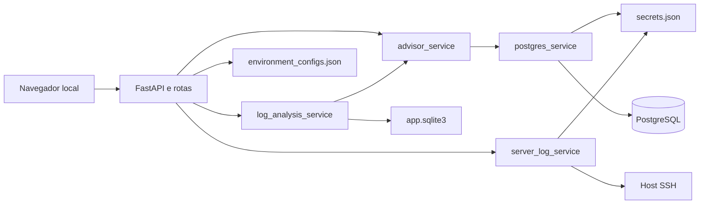

# Arquitetura

O PostgreSQL Database Tuning Advisor é uma aplicação FastAPI servida na estação do DBA. Templates Jinja2 montam as páginas. Não há API JSON de produto: o contrato é o formulário HTML e o HTML de resposta. A exceção é `GET /health`, que devolve o texto `ok`.

## Módulos

| Caminho | Papel |
| --- | --- |
| `app/main.py` | Cria o app, monta `/static`, inclui os routers e chama `init_store()` no startup |
| `app/web.py` | Jinja2 e o filtro `pretty_json` |
| `app/routes/context.py` | Monta ambiente ativo, conexão ativa, lista de bancos e erro de conexão para todas as páginas |
| `app/routes/*.py` | Uma área da interface por arquivo |
| `app/services/advisor_service.py` | Snapshot, regras, `EXPLAIN`, parser de query e comparação de índices |
| `app/services/log_analysis_service.py` | Lê o texto do log, agrupa e grava a análise |
| `app/services/server_log_service.py` | Monta o comando remoto e executa via Paramiko quando a confirmação vem marcada |
| `app/services/postgres_service.py` | Monta o conninfo e executa SQL de leitura com `psycopg` |
| `app/services/config_service.py` | Valida o formulário e separa segredo de metadado |
| `app/repositories/config_repository.py` | Lê e grava o JSON de ambientes e conexões |
| `app/repositories/log_repository.py` | SQLite do histórico |
| `app/security/secret_vault.py` | Cifra e decifra `data/secrets.json` |
| `app/security/secret_store.py` | Cache em memória na frente do cofre, mais redação |
| `app/security/redaction.py` | Troca senhas conhecidas, usuário:senha em URL e pares `password=` por `[REDACTED]` |
| `app/security/auth.py` | Gancho de login. `login_enabled()` devolve falso |
| `app/config/settings.py` | Defaults e leitura do `.env` |

As consultas PostgreSQL rodam em thread (`anyio.to_thread`), com conexão curta e `autocommit=True`. O dicionário `_pools` existe para invalidar conninfo ao salvar, testar ou trocar uma conexão. Cada chamada abre e fecha a própria `Connection`.

## Contexto de página

`build_context()` é o ponto único que decide o que a barra do topo mostra.

1. Carrega ambientes e o ambiente selecionado.
2. Lista só as conexões PostgreSQL desse ambiente.
3. Resolve a conexão selecionada. Se a conexão marcada pertence a outro ambiente, troca pela primeira conexão do ambiente atual.
4. Quando a página pede bancos, consulta `pg_database` (`datallowconn` e `datistemplate = false`).
5. O banco ativo começa em `selected_database` da conexão, com fallback para `default_database`.
6. Um `GET` com `set_db=1` e `db` presente na lista grava a escolha na conexão. É o seletor **Banco** do topo.
7. Um `POST` que envia `db` usa esse banco na requisição quando ele existe na lista. A gravação permanente continua sendo o seletor do topo.
8. Se o banco guardado sumiu da lista, a aplicação volta ao banco padrão, ou ao primeiro da lista, e grava esse valor.

Falha ao listar bancos vira `database_error` já redigido. As telas de ambiente e de conexão chamam o contexto com `include_databases=False` para não depender do PostgreSQL na hora de editar o cadastro.

## Persistência

### Configuração

`data/environment_configs.json` tem quatro chaves:

| Chave | Conteúdo |
| --- | --- |
| `selected_environment_id` | Ambiente ativo |
| `selected_postgres_id` | Conexão ativa |
| `environments` | Lista de hosts |
| `postgres_connections` | Lista de conexões, cada uma com `environment_id` |

A gravação escreve um `.tmp` e substitui o arquivo. Na leitura, um JSON inválido volta ao documento vazio. A migração automática preenche `environment_id` antigo, alinha a conexão selecionada ao ambiente selecionado e converte o antigo limite padrão de log (`32 MiB`) para `0` (sem corte pelo app).

Apagar um ambiente tira o item da lista e recalcula a seleção: se ele era o atual, entra o próximo da lista e a conexão ativa passa a ser uma conexão desse ambiente. As conexões PostgreSQL que apontavam para o ambiente removido continuam no JSON. A exclusão de ambiente ou de conexão também não apaga os tokens correspondentes em `secrets.json`. O cofre só perde um segredo quando o formulário troca o método SSH para chave, desliga o sudo ou substitui o valor.

### Cofre

Chaves no formato `escopo:id:campo`.

| Chave | Origem |
| --- | --- |
| `environment:<id>:ssh_password` | Senha SSH |
| `environment:<id>:sudo_password` | Senha sudo, quando não reutiliza a do SSH |
| `postgres:<id>:password` | Senha PostgreSQL |
| `postgres:<id>:manual_dsn` | DSN manual que contém senha |

O JSON de configuração marca `has_ssh_password`, `has_sudo_password` e `has_password`. A tela de conexão mostra **persistida** quando a flag e o cofre concordam, **requer salvar novamente** quando a flag existe e o cofre não abre, e **não salva** quando não há senha.

Deixar o campo de senha em branco numa edição preserva o segredo anterior. Trocar o método SSH para chave apaga a senha SSH do cofre. Desligar sudo, ou marcar "mesma senha do SSH", apaga a senha sudo própria.

### Histórico

`data/app.sqlite3`, criado no startup, em modo WAL.

| Tabela | Função |
| --- | --- |
| `log_runs` | Uma análise: data UTC, banco, ids de conexão e ambiente, origem (`manual` ou `ssh`), `min_ms`, linhas pedidas, comando redigido, erro, bytes e contagens |
| `log_groups` | Query normalizada, amostra, chamadas, total, média e máximo em ms |
| `log_recommendations` | Tipo, severidade, título, detalhe, SQL, confiança e evidência JSON |

Índices: grupos por `run_id, total_ms DESC`, recomendações por `run_id, severity, confidence DESC`, runs por `created_at DESC`.

A página de logs pagina grupos e recomendações com `LOG_CACHE_PAGE_SIZE` (padrão 50, limitado entre 5 e 500 no repositório). A lista recente em `/logs` mostra 15 runs. `/history` mostra 100.

Excluir runs selecionados apaga grupos e recomendações, depois recompacta os IDs restantes para 1..N. Limpar tudo (`confirm_text` igual a `LIMPAR`) zera as três tabelas e a sequência do SQLite. Outro texto de confirmação não apaga nada.

## Rotas

| Método | Caminho | Efeito |
| --- | --- | --- |
| GET | `/` | Dashboard |
| GET | `/health` | Texto `ok` |
| GET | `/environments` | Lista e formulário. `edit_id` carrega um item |
| POST | `/environments` | Salva e redireciona |
| POST | `/environments/select` | Define o ambiente ativo |
| POST | `/environments/delete` | Remove o ambiente |
| GET | `/postgres` | Lista só as conexões do ambiente ativo |
| POST | `/postgres` | Salva, fecha o cache da conexão e testa |
| POST | `/postgres/select` | Define a conexão ativa |
| POST | `/postgres/delete` | Remove a conexão |
| POST | `/postgres/test` | Testa sem alterar o formulário além do resultado |
| GET | `/catalog` | Snapshot e regras de catálogo |
| GET | `/recommendations` | Só as regras de catálogo |
| GET | `/query` | Formulário vazio |
| POST | `/query` | `EXPLAIN` e análise do plano |
| GET | `/logs` | Coleta, texto e a run pedida ou a mais recente do banco ativo |
| POST | `/logs/manual` | Analisa o texto e redireciona para `/logs?run_id=` |
| POST | `/logs/fetch` | Prévia ou execução SSH |
| GET | `/history` | Lista de análises |
| POST | `/history/delete-selected` | Apaga os IDs marcados. `return_to` só aceita `/history` ou `/logs` |
| POST | `/history/delete-all` | Exige `LIMPAR` |
| GET | `/login-settings` | Lista os prefixos previstos para proteção futura |

O FastAPI também publica `/docs` e `/redoc` porque a aplicação não desliga o OpenAPI. Com o bind em `127.0.0.1` isso fica na máquina local.

## Ordem de uma análise de log

1. A rota cria a run e devolve o `id` cedo, antes de parsear, para o histórico existir mesmo se a análise seguinte falhar no meio.
2. `iter_slow_log_entries` extrai duração e texto.
3. Entradas abaixo de `min_ms` contam como ignoradas.
4. As demais entram num grupo pela query normalizada.
5. Grupos ordenados por `total_ms` são gravados.
6. Até `MAX_LOG_RECOMMENDATION_GROUPS` grupos (mínimo interno 10, padrão 250) geram candidatos de índice, com teto `MAX_LOG_RECOMMENDATIONS`.
7. Cada candidato passa por `build_index_recommendation` no banco selecionado.
8. Contagens da run são atualizadas.

A origem `manual` não grava comando. A origem `ssh` grava comando redigido, linhas pedidas, bytes lidos e o flag de truncamento.

## O que o processo executa no PostgreSQL

| Ação da interface | SQL no servidor |
| --- | --- |
| Teste de conexão, dashboard | `version()`, `current_database()`, `current_user`, `inet_server_addr()`, `inet_server_port()` |
| Seletor de banco | `pg_database` |
| Dashboard e catálogo | Tamanho do banco e as 20 maiores tabelas de usuário (`relkind` `r` ou `p`) |
| Dashboard | Até 10 linhas de `pg_stat_statements`, se a view existir |
| Catálogo e `/recommendations` | Consultas de FK, estatística, PK, seq scan e índice sem uso |
| Analisar SQL | `EXPLAIN (...)` da query colada |
| Recomendação de índice | `pg_class`, `pg_attribute`, `pg_index`, `pg_stats` da tabela candidata |

`CREATE INDEX`, `ANALYZE` e `DROP INDEX` são strings na página. O processo não as envia ao servidor.
